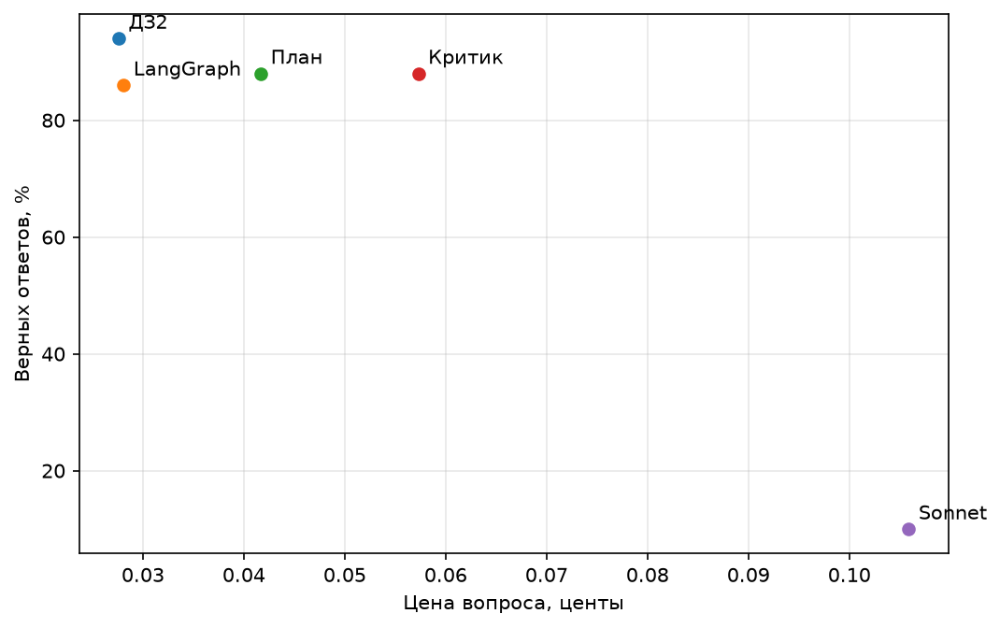

# ДЗ3. Сравнение агентов

Взяли агента из ДЗ2 с инструментом knowledge_base и Milvus и те же 50 вопросов.
Перенесли цикл на LangGraph, затем отдельно добавили планировщика и критика.
Сравнили точность и стоимость с исходным агентом и сильной моделью без инструментов.

| Вариант | Верных | Вызовов/вопрос | Токенов/вопрос | Центов/вопрос | Центов/верный |
|---|---:|---:|---:|---:|---:|
| Агент из ДЗ2 | 94% | 2.96 | 1651 | 0.0276 | 0.0293 |
| LangGraph | 86% | 2.98 | 1731 | 0.0281 | 0.0327 |
| LangGraph + план | 88% | 4.02 | 2457 | 0.0417 | 0.0473 |
| LangGraph + критик | 88% | 5.48 | 3779 | 0.0573 | 0.0651 |
| Sonnet без инструментов | 10% | 0.96 | 110 | 0.1059 | 1.0594 |

В отдбельном прогоне критик повысил точность с 86% до 88%:
исправил 1 ответ, испортил 0. Цена вопроса выросла с 0.0281
до 0.0573 цента.

Исходный агент дал лучшую точность и минимальную цену верного ответа.
План повысил точность LangGraph на 2 процентных пункта; критик в повторном
прогоне снизил её на 2 пункта. Оба варианта увеличили стоимость.

## Налог фреймворка

На простом вопросе первый запрос обычного цикла составил 183 токена,
LangGraph — 173. Промпт и описания аргументов сохранились; LangGraph
удалил служебные поля title из схемы инструмента, что объясняет
более короткий запрос.

### Разбор ошибок

Просмотрены все неверные ответы последнего сравнения: 7 у LangGraph
и 6 у варианта с критиком.

Шесть и пять ответов соответственно отсутствуют из-за лимита вызовов.
Ещё по одному ответу перепутали победителей Barcelona-Catalunya
и Spanish Grand Prix; ошибка подтверждается сохранённым корпусом.