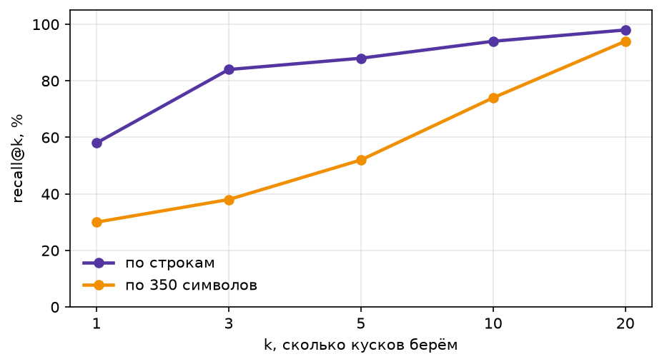
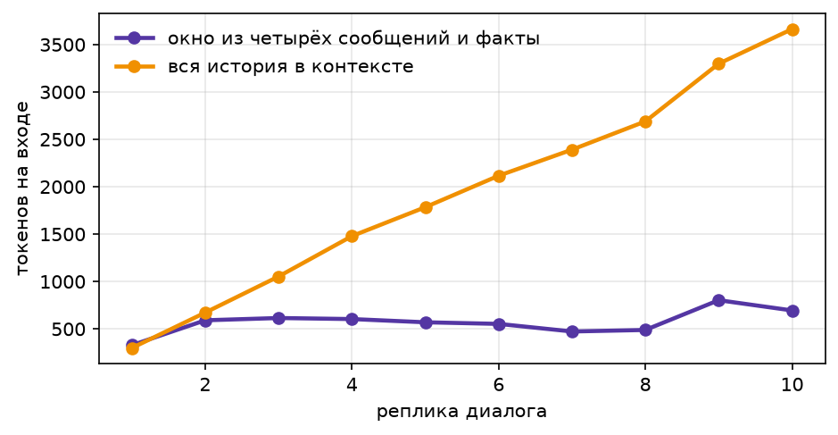

# ДЗ2. База знаний и память агента

Агент отвечает на вопросы по локальному корпусу с помощью Milvus и сохраняет факты о пользователе между сессиями.

## Запуск

Запустить Docker Desktop, затем в корне репозитория:

```bash
python -m pip install -r requirements.txt
cp .env.example .env
docker compose up -d milvus
```

Добавить ключ OpenRouter в `.env`. Открыть `src/main.ipynb`, выбрать установленное Python-окружение и выполнять ячейки сверху вниз.


## Корпус

15 страниц о Formula 1, Grammy, чемпионате мира по футболу, Super Bowl и зимней Олимпиаде 2026 года.
За образец взят файл из ДЗ1.

## Нарезка и поиск

Сравниваются две нарезки:

- По строкам — 579 кусков. Граница сохраняет целую строку таблицы или абзац статьи.
- По 350 символов — 330 кусков. Текст делится независимо от структуры.

### Recall@k

| k | По строкам | По символам |
|---|---:|---:|
| 1 | 58% | 30% |
| 3 | 84% | 38% |
| 5 | 88% | 52% |
| 10 | 94% | 74% |



### Гибридный поиск

Выдачи векторного поиска и поиска по словам объединяются через RRF.

| Нарезка | Поиск | Recall@1 | Recall@5 |
|---|---|---:|---:|
| По строкам | Вектор | 58% | 88% |
| По строкам | Слова | 24% | 44% |
| По строкам | Гибрид | 42% | 70% |
| По символам | Вектор | 30% | 52% |
| По символам | Слова | 30% | 40% |
| По символам | Гибрид | 32% | 50% |

Гибрид оказался хуже векторного поиска по recall@5, поэтому для ответов оставлен векторный поиск.

## Результаты ответов

Все конфигурации проверены на 50 вопросах.

| Конфигурация | Верных ответов | Цена вопроса | Цена верного ответа |
|---|---:|---:|---:|
| GPT-4o mini без инструментов | 4% | 0.00001 | 0.00035 |
| Sonnet 4.6 без инструментов | 10% | 0.00105 | 0.01047 |
| GPT-4o mini + RAG | 64% | 0.00006 | 0.00009 |
| Haiku 4.5 + RAG | 74% | 0.00068 | 0.00092 |
| Sonnet 4.6 + RAG | 84% | 0.00188 | 0.00224 |
| GPT-4o mini + knowledge_base | 92% | 0.00028 | 0.00031 |


Инструмент `knowledge_base` позволяет агенту самому формировать запросы и обращаться к базе несколько раз.


## Отказы

Результаты GPT-4o mini + RAG, k=5:

| Проверка | Результат |
|---|---:|
| Отказы на вопросах без ответа | 10 из 10 |
| Ошибочные отказы на вопросах с ответом | 19 из 50 |

Система отклонила все вопросы без ответа, но иногда отказывалась и при наличии нужных сведений.

## Разбор ошибок

Примеры взяты из Sonnet 4.6 + RAG — лучшей конфигурации среди вариантов с постоянным поиском.

**Поиск не нашёл.** На вопрос о победителе Гран-при Китая в контекст попали заголовок таблицы результатов и фрагменты статьи о Сингапуре. Строки с Кими Антонелли не было, модель отказалась отвечать.

**Нашёл, но проверка засчитала ошибку.** На вопрос о Best Pop Duo/Group Performance в контексте были Cynthia Erivo и Ariana Grande. Модель назвала обеих, но проверка ожидала непрерывное совпадение с эталоном, где имена разделены запятой.

## Память

Сравнение двух режимов на десяти пользовательских репликах:

| Режим | Входные токены | Стоимость ответов, USD |
|---|---:|---:|
| Окно и факты | 5 721 | 0.00115 |
| Вся история | 19 444 | 0.00215 |



## Вывод

RAG повысил точность дешёвой модели с 4% до 64%. Агент с инструментом достиг 92%, но оказался дороже постоянного RAG. Самый дешёвый верный ответ получился у GPT-4o mini + RAG.

Память сократила входной контекст примерно в 3,4 раза и снизила стоимость ответов в диалоге.