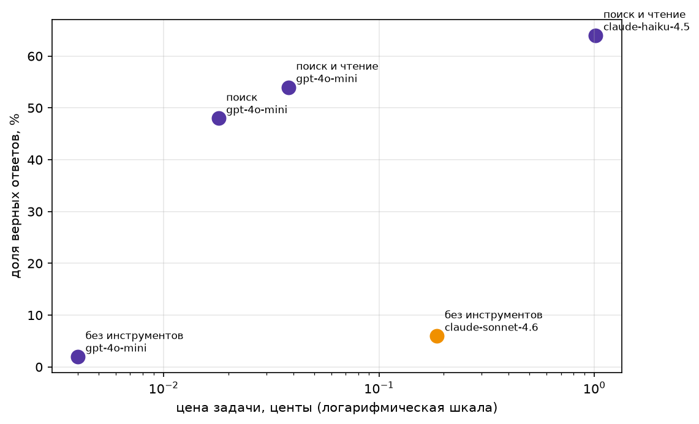

# Домашнее задание 1

## Датасет

Собрал собственные 50 вопросов о событиях 2026 года: формула 1, кино и музыка. Переписал поиск по википедии на собственный, разделил на два инструмента: поиск по заголовкам и парсер тела страницы по ключевым словам.

Файл: `data/fresh_custom_2026.jsonl`.

Проверка свежести: Sonnet ответил правильно на 5 из 50 вопросов — **10%**, что ниже порога 20%. Вывод проверки находится в `results/fresh_check.txt`.

## Запуск

Установить зависимости:

```bash
pip install -r requirements.txt
```

В `.env` по примеру `.env.example` и указать ключ OpenRouter. Прогнать ячейки `src/main.ipynb` по порядку.

## Результаты

Таблица тестового прогона на `data/fresh_custom_2026.jsonl`
| Конфигурация | Верных | Цена задачи | Цена верного ответа | Шагов | Время, с |
|---|---:|---:|---:|---:|---:|
| Sonnet без инструментов | 6% | 0.00186 | 0.03098 | 1.00 | 3.4 |
| GPT-4o-mini без инструментов | 2% | 0.00004 | 0.00201 | 1.00 | 2.2 |
| GPT-4o-mini с поиском | 48% | 0.00018 | 0.00038 | 2.48 | 17.3 |
| GPT-4o-mini с поиском и чтением | 54% | 0.00038 | 0.00070 | 3.08 | 26.2 |
| Haiku с поиском и чтением | 64% | 0.01015 | 0.01586 | 3.32 | 43.3 |



CSV находятся в `results`, JSON-трейсы — в `traces`.

## Ошибки

Большая часть неудач вызвана сбоями инструментов: таймаутами, пустой выдачей поиска и HTTP 403 при чтении страниц. Были просто неудачные запросы и неподходящие источники.

Два трейса с ошибкой:

- [custom-2026-15](traces/поиск%20и%20чтение/gpt-4o-mini/custom-2026-15.json): поиск не нашёл нужный источник за 2026 год и вернул статью за 2012 год.
- [custom-2026-11](traces/поиск%20и%20чтение/gpt-4o-mini/custom-2026-11.json): правильный ответ «Макс Ферстаппен» не совпал с английским эталоном `Max Verstappen`.

Проверка также не учитывала ответы вроде `9` и `nine years`, порядок имён и разные записи счёта. Но даже с учетом этой проблемы общая тенденция сохранена, поэтому код проверки не исправлял.

## Вывод

На этом наборе тезис подтвердился: дешёвая модель с инструментами ответила лучше и стоила меньше Sonnet без инструментов. Haiku повысил качество, относительно "глупого" gpt, но оказался дороже.